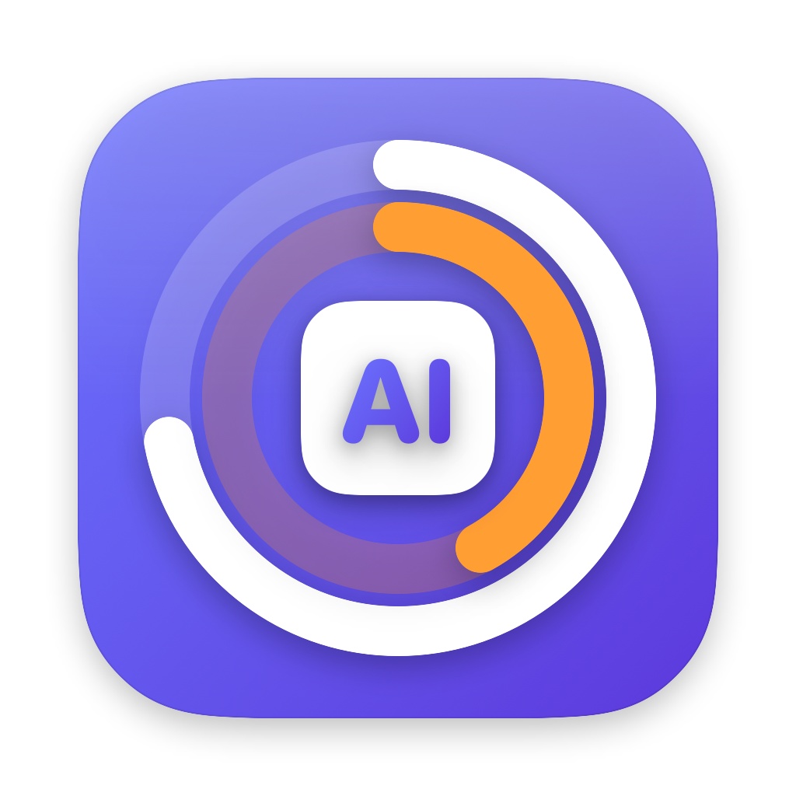
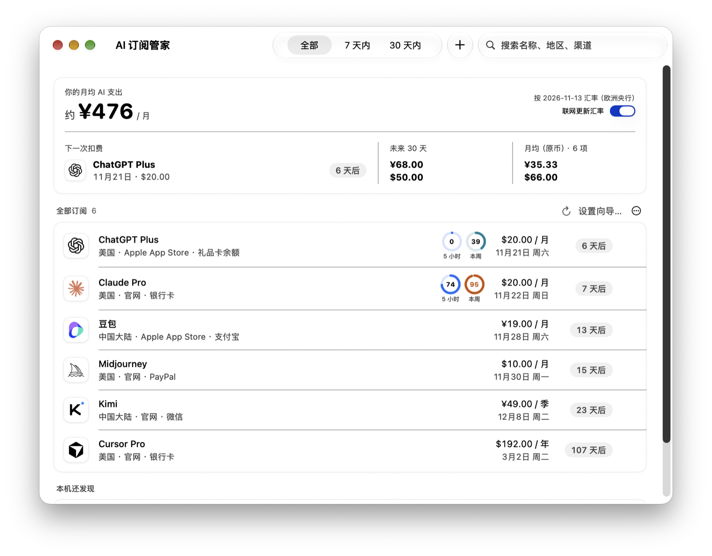
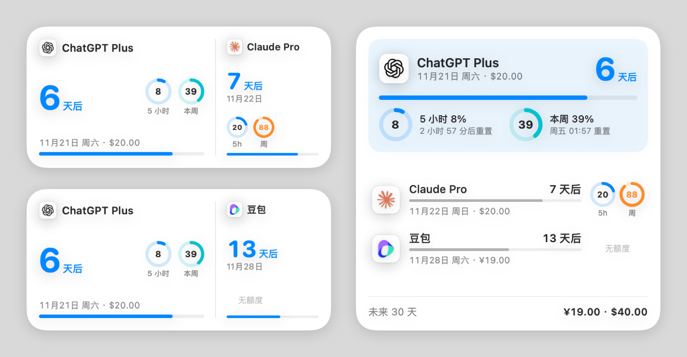

<p align="center"></p>

# AI 订阅管家

一个原生 macOS 应用，集中管理国内外 AI 服务的订阅：记下每项订阅的费用和扣费日，看还有几天续费；还能自动识别本机 Codex、Claude Code 的订阅，显示 5 小时和每周额度，并提供桌面小组件。

> 适用于 macOS 14 及以上。数据全部保存在本机，不需要注册账号。





图文介绍见 [docs/介绍.md](docs/介绍.md)。

## 功能

- **订阅记账**：19 个常用 AI 服务（ChatGPT / Codex、Claude、Gemini、Cursor、DeepSeek、豆包、Kimi……）可一键选择，也支持自定义项目。记录金额与币种、月付 / 季付 / 年付 / 自定义周期、扣费日、地区（美国、中国大陆、香港、日本、韩国、土耳其、加拿大、欧洲……）、订阅渠道和支付方式。
- **续费倒计时**：按下次扣费排序，进入提醒期标橙；概览显示未来 30 天和月均支出（按原币种分别汇总）。
- **月均支出换算**：顶部显示“你的月均 AI 支出：约 ¥XXX”，把各币种按月折算后换成人民币。内置一份欧洲央行参考汇率（2026-11-13）保证离线可用；开启“联网更新汇率”时每 12 小时从 [Frankfurter](https://frankfurter.dev)（欧洲央行数据，免密钥）更新一次，联网失败则继续用已有汇率。
- **本机识别**（需授权，可随时关闭）：扫描已安装的 AI 工具，从 Codex、Claude Code 的本地登录信息识别订阅档位和续费日；还没加进订阅的工具显示在列表下方“本机还发现”，点一下导入或添加。
- **5 小时 / 每周额度**：ChatGPT（Codex）与 Claude 订阅的额度用圆环显示，用到 80% 标橙、用完标红，附重置时间。
- **设置向导**：检测 Codex、Claude Code 是否安装和登录，提供“在终端运行”按钮和可复制的命令。
- **桌面小组件**：“即将扣费”（中号、大号），包含续费倒计时、本期进度条和额度圆环；另有“AI 额度”小组件。可选纯白或玻璃背景。

## 下载安装

1. 到 [Releases](https://github.com/mujingquan835/ai-subs/releases/latest) 下载 `ai-subs-x.x.zip`（约 3 MB，同时支持 Apple 芯片和 Intel 芯片，需要 macOS 14 及以上）。
2. 双击解压，把 **AI订阅管家.app** 拖进“应用程序”文件夹。桌面小组件只在 App 位于“应用程序”时可用。
3. 第一次打开：目前是测试版，没有经过苹果公证，双击时系统会提示“无法验证开发者”。点“完成”，然后打开 **系统设置 → 隐私与安全性**，在页面下方找到“已阻止使用 AI订阅管家”，点 **仍要打开** 并确认。之后就能正常打开了。

也可以在终端用一行命令解除限制：

```bash
xattr -dr com.apple.quarantine "/Applications/AI订阅管家.app"
```

> 测试版用开发者证书签名、未经公证。小组件与 App 之间的数据共享在其他 Mac 上还没有充分验证，如果小组件一直显示“还没有订阅”，欢迎提 Issue。

## 从源码构建

普通使用不需要这一步，只有想自己修改代码时才需要。

1. 安装 [Xcode](https://apps.apple.com/app/xcode/id497799835) 和 [XcodeGen](https://github.com/yonaskolb/XcodeGen)（`brew install xcodegen`）。
2. 在 Xcode → 设置 → 账户里登录你的 Apple ID（免费账号即可），让钥匙串里有一张 “Apple Development” 证书。小组件与 App 共享数据需要签名。
3. 运行安装脚本：

```bash
./scripts/install.sh
```

脚本会自动从证书里读取你的团队 ID、构建、安装到 `/Applications/AI订阅管家.app`，并让系统重新加载小组件。也可以手动指定团队：`AISUB_TEAM_ID=你的团队ID ./scripts/install.sh`。

想用 Xcode 打开：`AISUB_TEAM_ID=你的团队ID xcodegen generate`，然后打开生成的 `AISubscriptions.xcodeproj`。

> 小组件只有在 App 位于 `/Applications` 时才会出现在小组件库里。更新后桌面仍显示旧样式时，删掉小组件重新添加。

## 自动识别与额度是怎么工作的

首次打开时，首页会说明会读取哪些内容，点“允许并扫描”后才开始。之后可在“本机 AI 工具”右侧打开**设置向导**，按提示安装和登录：

| 服务 | 需要 | 读取的位置 | 额度来源 |
| --- | --- | --- | --- |
| ChatGPT / Codex | 安装 Codex（命令行或桌面 App）并用 ChatGPT 账号登录：`codex login` | `~/.codex/auth.json` | `chatgpt.com/backend-api/wham/usage`（Codex 自己的 `/status` 同源） |
| Claude | 安装**终端版** Claude Code，运行 `claude` 后输入 `/login`，用订阅账号登录 | `~/.claude.json`、钥匙串 “Claude Code-credentials”（通过系统 `security` 工具） | `api.anthropic.com/api/oauth/usage`（Claude Code 自己的 `/usage` 同源） |

注意事项：

- **Claude 桌面 App 的登录读不到**，必须是终端版 Claude Code 登录。Claude Code 配置了第三方模型也可以登录，不会影响原来的模型设置；但这种情况下 Claude Code 不会自动续期订阅令牌，大约 8 小时后需要重新 `/login`。
- 额度接口是这些工具内部使用的非公开接口，厂商变更后可能失效，届时只显示错误提示，不影响记账。
- 应用只读取登录信息，**不会刷新或改写令牌**，以免让原工具的登录失效。查询只连接 OpenAI 与 Anthropic 官方服务器。
- App 运行时每 5 分钟刷新一次额度；关闭后小组件显示最后一次的数据。
- 凭证里没有价格信息，导入时金额需要自己填写。应用不维护任何官方价格表。

## 隐私

- 订阅数据保存在本机：`~/Library/Group Containers/<团队ID>.local.dawang.aisubscriptions/subscriptions.json`。
- 不收集、不上传任何数据，没有统计或埋点。联网只有两处：查询额度（OpenAI / Anthropic 官方）和更新汇率（Frankfurter，可在首页关闭）。
- 自动识别可以在“本机 AI 工具”右侧菜单里随时关闭，关闭后会清除已保存的额度数据。

## 项目结构

```text
App/        主窗口、编辑表单、本机识别、设置向导
Shared/     订阅模型与日期计算、额度模型、服务目录、图标组件（App 与小组件共用）
Widgets/    桌面小组件
Resources/  服务图标与来源说明
scripts/    安装脚本
docs/       需求文档、设计稿与预览图
project.yml XcodeGen 工程定义
```

## 开发状态

已完成：订阅增删改、月付 / 季付 / 年付 / 自定义周期、续费倒计时与概览、服务图标目录、本机识别与一键导入、Codex 与 Claude 额度（均已用真实账号实测）、设置向导、“即将扣费”与“AI 额度”小组件（已在桌面实测显示）。

待完成：系统通知提醒、独立开始日期与账单时区、备份导出与恢复、Gemini / Antigravity 额度、验收测试、经过苹果公证的正式版安装包（当前 Releases 提供未公证的测试版，构建脚本 `scripts/release.sh`）。纯白 / 玻璃背景切换与小组件跨日刷新尚未实测。

## 致谢与许可

- 服务图标来自 [LobeHub Icons](https://github.com/lobehub/lobe-icons)（MIT），来源和对应关系见 [Resources/ICON_SOURCES.md](Resources/ICON_SOURCES.md)。各标志为对应公司的商标，仅用于识别服务。
- 本机识别与额度查询的思路参考了 [magpie](https://github.com/yetone/magpie)（MIT），未复制其代码。
- 本项目以 [MIT 许可证](LICENSE) 开源。本项目与 OpenAI、Anthropic、Google 等公司无关。
