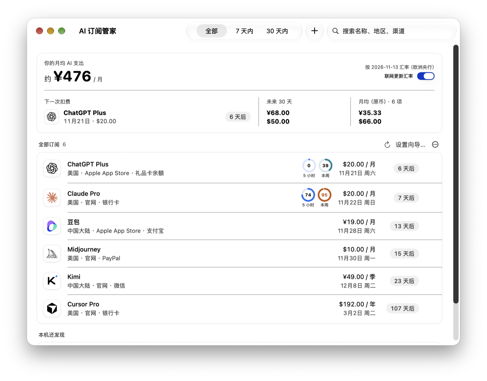
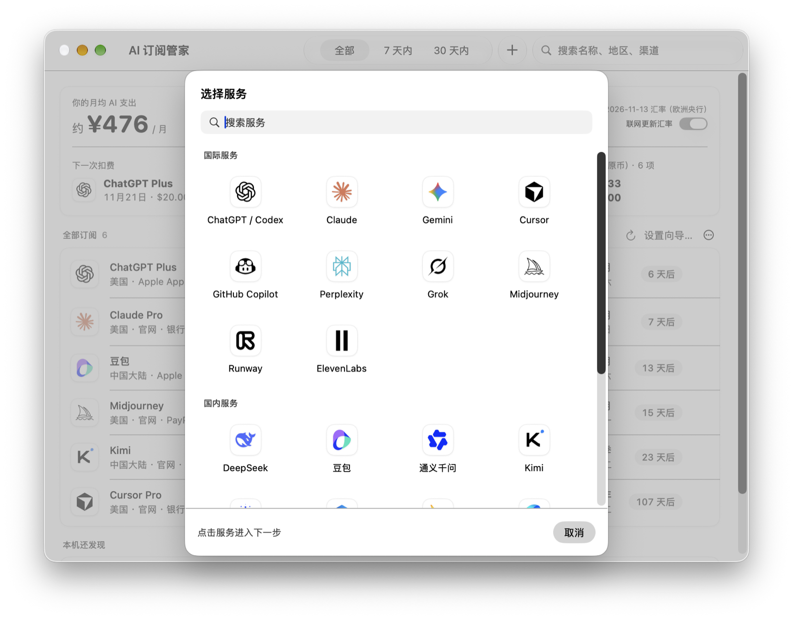
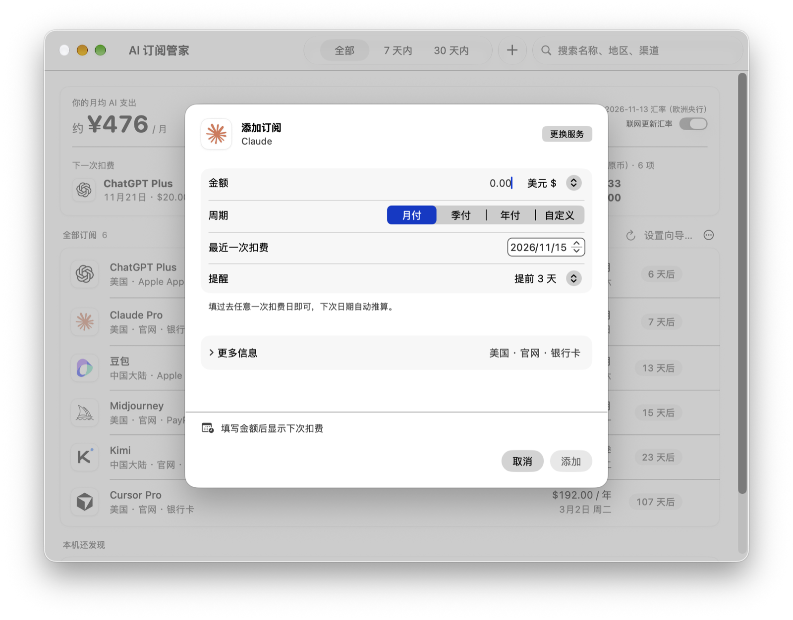
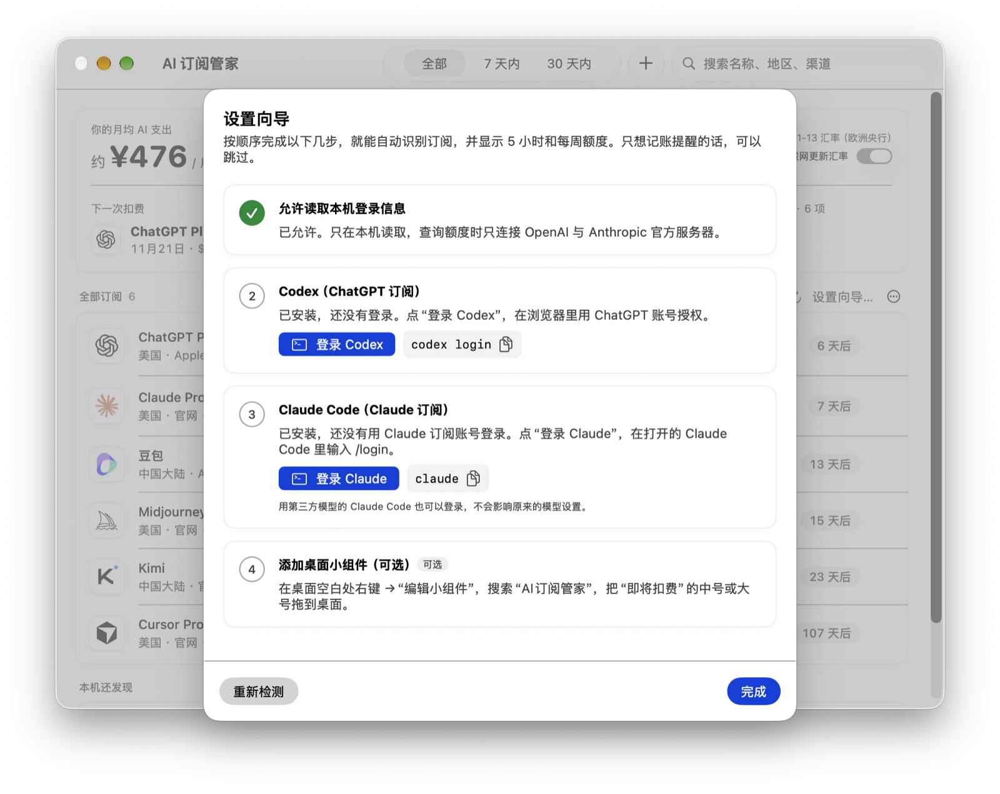
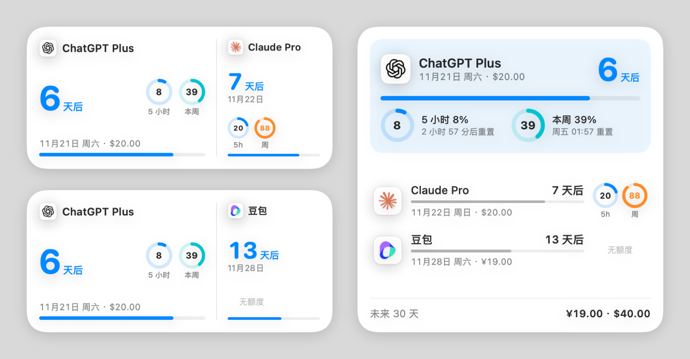

<p align="center"></p>

<h1 align="center">AI 订阅管家</h1>

<p align="center">一个原生 macOS 小工具：AI 订阅什么时候续费、每月花多少钱、Codex 和 Claude 的额度还剩多少，一眼看清。</p>

<p align="center"><a href="https://github.com/mujingquan835/ai-subs">github.com/mujingquan835/ai-subs</a> · 开源免费 · MIT 许可证</p>

---

## 为什么做这个

现在很多人同时开着好几个 AI 订阅：ChatGPT、Claude、Cursor、Midjourney，再加上豆包、Kimi 这些国内服务。有的走美区 App Store、用礼品卡付款，有的走官网绑卡；有的按月扣、有的按年扣；币种有美元、人民币，还有土耳其里拉。

结果就是：**不知道下一笔什么时候扣，不知道每个月一共花了多少，礼品卡余额常常不够，额度还动不动就用完。**

AI 订阅管家把这些集中到一个窗口和一个桌面小组件里。

## 一个窗口看清所有订阅



- **顶部直接给出月均支出**：各币种按月折算，再按汇率统一换成人民币，比如“约 ¥476 / 月”。汇率内置一份欧洲央行参考价，联网时每 12 小时自动更新。
- **按续费时间排序**：每项显示金额、周期、下次扣费日和“还有几天”，进入提醒期会标橙。
- **未来 30 天要扣多少**：按币种分开列出，不会把美元和人民币直接相加。
- **Codex、Claude 的额度直接显示在列表里**：两个小圆环分别是 5 小时额度和每周额度，用到 80% 变橙、用完变红，鼠标悬停能看到重置时间。

## 添加一项订阅，只要几秒

<table>
<tr>
<td width="50%"></td>
<td width="50%"></td>
</tr>
</table>

- 19 个常用 AI 服务带官方图标，国际、国内分组，可以搜索，也能自定义。
- 表单只留最关键的四项：**金额、周期、最近一次扣费日、提前几天提醒**。地区、渠道、支付方式收在“更多信息”里，收起时也能看到当前的选择。
- 支持美国、中国大陆、香港、日本、韩国、土耳其、加拿大、欧洲等地区，以及美元、人民币、港币、日元、欧元、英镑、韩元、土耳其里拉、加元。
- 扣费日填过去任意一次即可，下次日期自动推算；31 号这种月底日期也会正确处理。

## 自动识别本机订阅，一键导入

如果你在用 Codex 或终端版 Claude Code，授权后它会：

- 识别本机装了哪些 AI 工具；
- 从 Codex、Claude Code 的本地登录信息里读出**订阅档位**（比如 ChatGPT Plus、Claude Pro）和**续费日**，一键导入；
- 定时查询 **5 小时额度和每周额度**。

第一次使用有**设置向导**：自动检测有没有安装、有没有登录，每一步都有“在终端运行”按钮和可复制的命令，不用自己查文档。



> 小提示：Claude 的额度需要**终端版** Claude Code 登录（运行 `claude` 后输入 `/login`），Claude 桌面 App 的登录无法读取。Claude Code 配了第三方模型也能登录，不影响原来的模型设置。

## 桌面小组件



- **中号**：左边是最先续费的一项（大字倒计时、额度圆环、本期进度条），右边是第二项。
- **大号**：置顶卡片带额度重置时间，下面再列两项，底部是未来 30 天合计。
- 进度条表示这一期过去了多少，越满越接近续费；没有额度数据的服务显示“无额度”。
- 可以选纯白或玻璃背景。

## 隐私

- 订阅数据只保存在你自己的 Mac 上，不需要注册账号，没有任何统计或埋点。
- 自动识别必须你点“允许”才会开始，随时可以关闭。
- 只读取登录信息，不会刷新或改写登录令牌，不会影响原工具的登录。
- 联网只有两处：查询额度（只连 OpenAI 与 Anthropic 官方服务器）、更新汇率（Frankfurter，可关闭）。

## 怎么安装

目前需要从源码构建，步骤不多：

1. 安装 Xcode 和 XcodeGen（`brew install xcodegen`）；
2. 在 Xcode → 设置 → 账户里登录 Apple ID（免费账号即可）；
3. 下载源码后运行：

```bash
git clone https://github.com/mujingquan835/ai-subs.git
cd ai-subs
./scripts/install.sh
```

脚本会自动完成签名、构建和安装，App 会出现在“应用程序”里。

## 说明

- 额度查询用的是 Codex、Claude Code 自己内部使用的接口，厂商变更后可能失效，届时只会显示提示，不影响记账。
- 应用不维护任何官方价格表，金额以你实际的账单为准。
- 服务图标来自 LobeHub Icons，各标志属于对应公司；本项目与 OpenAI、Anthropic、Google 等公司无关。

欢迎在 GitHub 上提 Issue 和建议：[mujingquan835/ai-subs](https://github.com/mujingquan835/ai-subs)
